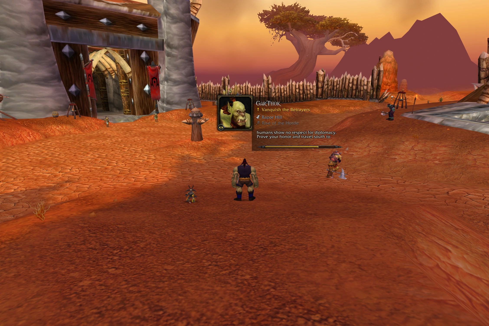
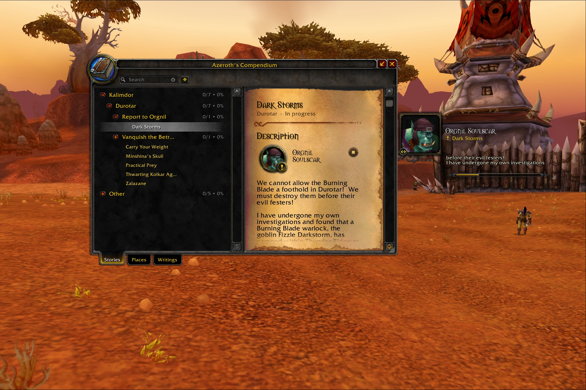
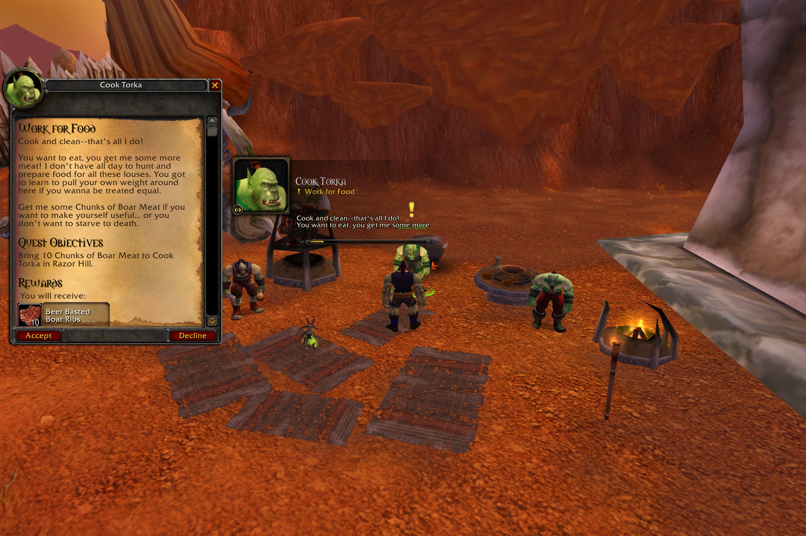
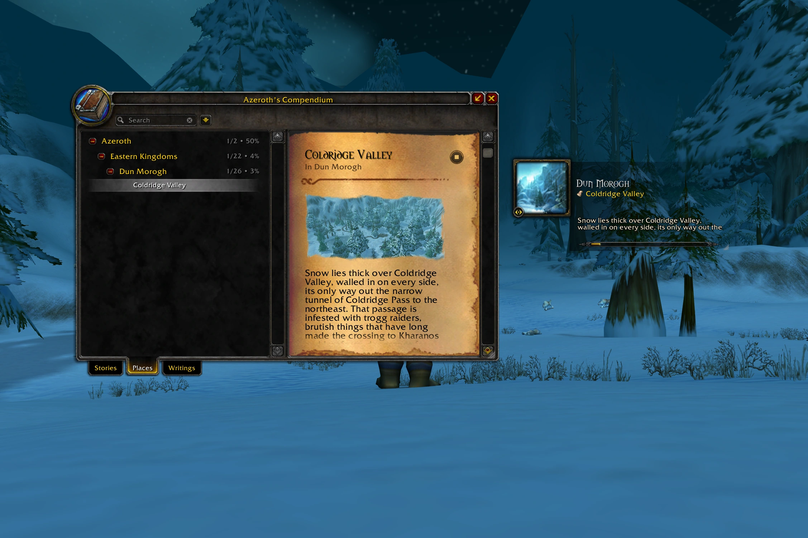
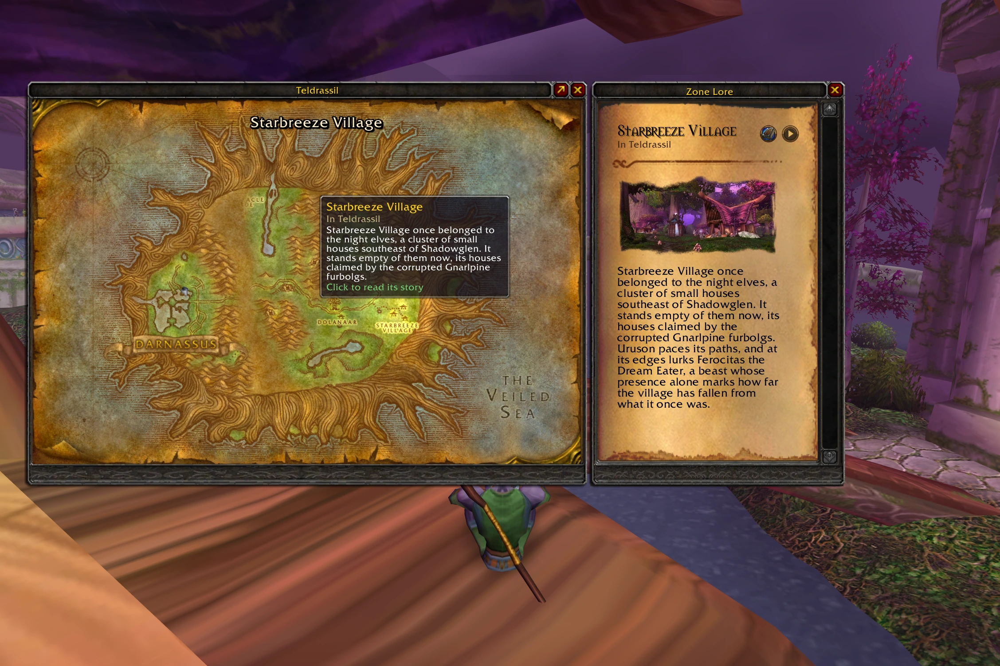
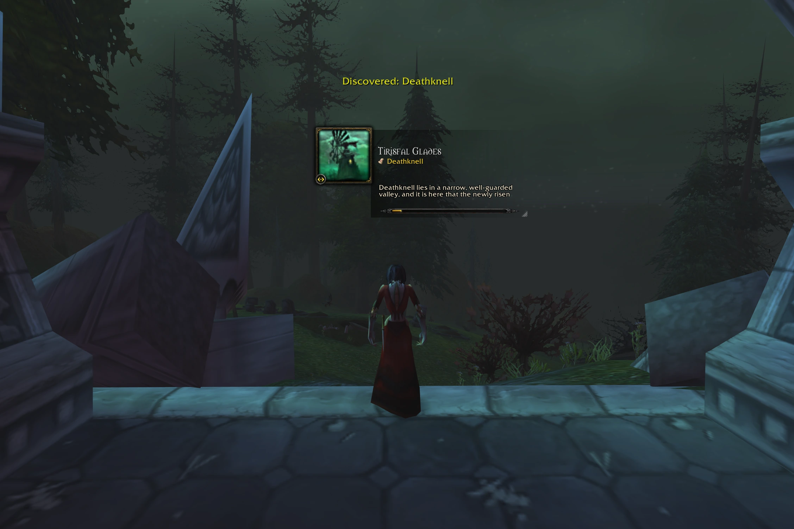
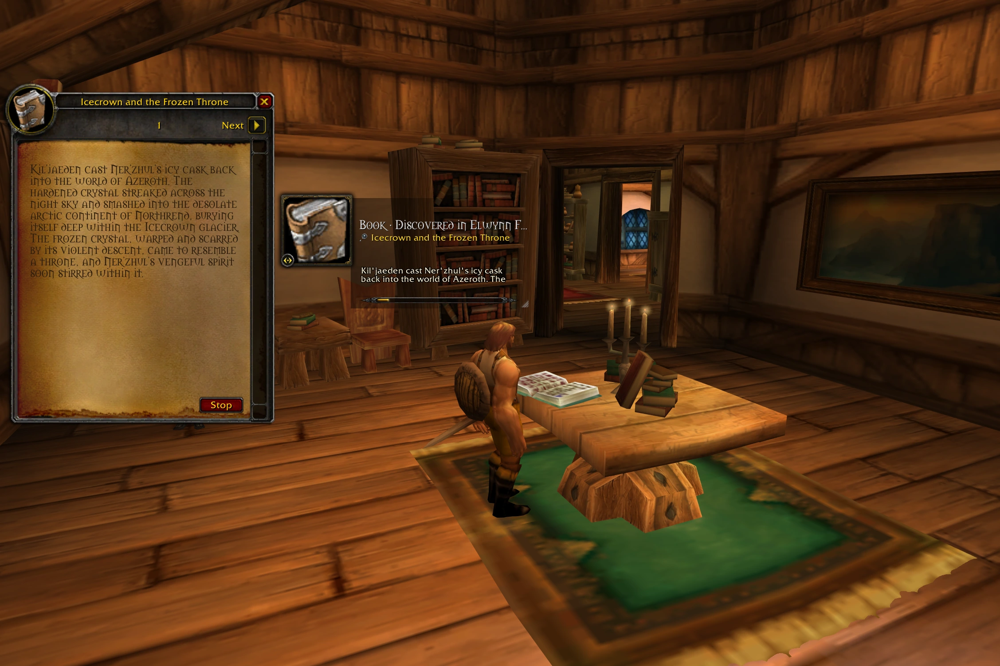
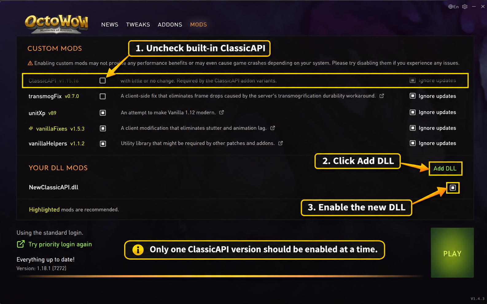

# SoftSpoken v0.8.1 βeta
*Voiced dialogue, lore, and text for World of Warcraft Vanilla.*

<p align="center">
  
</p>

SoftSpoken brings Azeroth to life through narrated quests, NPC conversations, books, and exploration, alongside an in-game Compendium for revisiting the world you've discovered.

The project is primarily developed for **Turtle WoW** successors and related Vanilla-based experiences, such as **OctoWoW**.

Considerable effort has gone into making SoftSpoken feel at home in the original game. Its interface draws extensively from Blizzard's own artwork and design conventions, with the aim of making its additions feel like a natural extension of Vanilla's own UI.

SoftSpoken is an ongoing effort to bring [Spoken](https://github.com/rusty-key/spoken-wow) to the original World of Warcraft 1.12 client, making use of the capabilities provided by ClassicAPI and other client extensions where appropriate. This is less a straightforward compatibility patch than an extensive reworking of Spoken, rebuilding and adapting its components to the capabilities and limitations of the original Vanilla client.

Whether you're already familiar with the projects SoftSpoken builds upon, or are encountering them for the first time, the following overview introduces its capabilities.

## How SoftSpoken Works

SoftSpoken consists of a central module, simply titled **SoftSpoken**, which provides the narration player and shared audio system that the specialized modules rely on for playback. It also hosts the underlying framework of the **Compendium**, a unified interface for browsing the game's narrated content.



There are currently three specialized modules, with at least one more planned:

- **[SoftSpoken Stories](#stories)** — Handles the narration of quests and NPC conversations, keeping a record of quests you've undertaken and their associated dialogue, from acceptance to completion.

- **[SoftSpoken Places](#places)** — Provides narrated lore for Azeroth's zones and subzones as you explore, tracking the places you've discovered and integrating with the World Map.

- **[SoftSpoken Writings](#writings)** — Narrates books, letters, notes, and other readable objects encountered throughout the world, maintaining a record of your discoveries and reading history.

### The Compendium



Each module has a dedicated tab within the Compendium, containing a catalogue of its respective entries.

By default, the Compendium follows a **discovery-based approach**, intended to complement exploration and preserve the experience of a blind playthrough. Content is progressively unlocked through your adventures:

- **Stories:** Quests are recorded as they're accepted, with completion dialogue becoming available once the quest has been completed.
- **Places:** Lore is unlocked as you encounter and discover locations throughout Azeroth.
- **Writings:** Books and other readable objects are unlocked as you discover and inspect them.

Undiscovered entries remain locked, allowing the Compendium to grow alongside your character's journey rather than reveal everything from the outset.

However, this behavior is entirely optional. Players who prefer to explore the lore without these restrictions can unlock undiscovered entries, effectively turning the Compendium into a more traditional **encyclopedia of Azeroth**.

## Stories

SoftSpoken Stories provides narration for quests and NPC gossip throughout the game. Narration can play automatically as you interact with NPCs, with configurable behavior for greetings, conversations, and quest dialogue.

Within the Compendium, Stories maintains a record of the quests you've encountered, organizing them by location and quest chain. Each entry provides access to its associated dialogue and available recordings, allowing you to revisit earlier encounters without returning to the original NPC.



## Places

SoftSpoken Places brings narrated lore to the world's zones and subzones, providing historical background and descriptions of the locations you encounter throughout your travels. Narration can be triggered automatically as you discover new areas or played manually through the Compendium.

Places also integrates directly with the in-game World Map, providing access to its lore without having to leave the map interface.



The World Map can also display lore for a selected location:



Discovering new areas can trigger a narration notification in the game world:



## Writings

SoftSpoken Writings provides narration for supported books, letters, scrolls, notes, and other readable objects encountered during your adventures.

When reading an object in the world, narration follows the page currently being viewed. When revisiting it through the Compendium, playback can continue through the entire work.



## Requirements

SoftSpoken is designed for World of Warcraft 1.12 clients, primarily OctoWoW and related Vanilla-based environments.

**[ClassicAPI](https://github.com/brues-code/ClassicAPI) is a mandatory dependency.** SoftSpoken relies on functionality provided by ClassicAPI and will not function correctly without it.

### OctoWoW Users

SoftSpoken needs **ClassicAPI** to be loaded by the game client, not simply present as an addon in `Interface\\AddOns`.

The OctoWoW launcher includes ClassicAPI under the **Mods** tab, but its bundled version may be older than the latest [official release](https://github.com/brues-code/ClassicAPI/releases/latest). Some users have experienced crashes with older ClassicAPI versions. Upgrading from the launcher-provided v1.15.16 to v1.20.4 resolved the crashes.

**I recommend updating ClassicAPI when possible**, especially if you experience crashes or other compatibility issues.

#### Updating ClassicAPI in OctoWoW

1. Open the OctoWoW launcher, go to **Mods**, and **uncheck the built-in ClassicAPI** option.
2. Download `ClassicAPI.dll` from the [latest ClassicAPI release](https://github.com/brues-code/ClassicAPI/releases/latest). It is a DLL file; no extraction is needed if you download it directly.
3. Rename the file to something recognizable, such as `NewClassicAPI.dll` (keep the `.dll` extension), and put it in the main OctoWoW folder alongside `WoW.exe`.
4. In the launcher's **Mods** tab, scroll to **Your DLL Mods**, choose **Add DLL**, and select your downloaded DLL.
5. Enable the new DLL in the launcher, then start the game normally.

<p align="center">
  
</p>

**Do not enable two versions of ClassicAPI at once.** Leave the built-in ClassicAPI unchecked while using your manually installed copy.

You can find the source code and releases in the [ClassicAPI repository](https://github.com/brues-code/ClassicAPI).

## Installation

1. **Enable ClassicAPI**, preferably the [latest version](https://github.com/brues-code/ClassicAPI/releases/latest), before starting the game. OctoWoW users can follow the [update instructions above](#updating-classicapi-in-octowow).
2. Download **[SoftSpoken-v0.8.1-beta.zip](https://github.com/z1xel/SoftSpoken/releases/download/v0.8.1-beta/SoftSpoken-v0.8.1-beta.zip)** and extract it.
3. Find the following four addon folders in the extracted contents and copy them into your World of Warcraft 1.12 `Interface\AddOns` directory:

   ```text
   Interface/
   └── AddOns/
       ├── SoftSpoken/
       ├── SoftSpoken_Stories/
       ├── SoftSpoken_Places/
       └── SoftSpoken_Writings/
   ```
4. Launch the game and enable SoftSpoken and its modules in the **AddOns** menu at character selection. Enable **Load out of date AddOns** if necessary.

Use `/softspoken` to open settings or `/compendium` to open Azeroth's Compendium. The Compendium also has a default keybinding of **J**, provided that key was not already assigned to another action.

**Voice packs are installed separately** as described below.

### OctoWoW Launcher Compatibility

The OctoWoW launcher may not recognize manually installed copies of SoftSpoken correctly. As a result, it may display SoftSpoken as missing or report missing dependencies for SoftSpoken Stories, Places, or Writings.

**These warnings do not necessarily indicate a broken installation.**

<p align="center">
  
</p>

If chat commands work and the addon functions normally, the launcher's dependency warnings can be safely ignored.

### Voice Packs

SoftSpoken does not generate speech itself. Audio is provided through separately installed voice packs, which the corresponding modules recognize and use for playback.

This allows different voice packs to be installed, combined, or updated independently of SoftSpoken itself.

To enable narration, install compatible voice packs for whichever modules you intend to use.

| Module | Voice pack |
|---|---|
| **Stories** | [Spoken Quests Audio: All](https://github.com/rusty-key/spoken-wow/releases/tag/quests-audio/v2.4.0) — quests and NPC gossip |
| **Places** | [Spoken Zones Audio — Vanilla 1.12](https://github.com/z1xel/SoftSpoken/releases/download/audio-vanilla-112-v1/SpokenZonesAudio-2.0.1-1.12.zip) — zones and subzones |
| **Writings** | [Spoken Books Audio — Vanilla 1.12](https://github.com/z1xel/SoftSpoken/releases/download/audio-vanilla-112-v1/SpokenBooksAudio-2.1.2-1.12.zip) — books and other readable objects |

These voice packs originate from [Spoken](https://github.com/rusty-key/spoken-wow) by Rusty Key. The **Places** and **Writings** downloads above are [Vanilla 1.12-compatible repacks](https://github.com/z1xel/SoftSpoken/releases/tag/audio-vanilla-112-v1) of the [original Zones](https://github.com/rusty-key/spoken-wow/releases/tag/zones-audio/v2.0.1) and [Books](https://github.com/rusty-key/spoken-wow/releases/tag/books-audio/v2.1.2) releases. Only the addon manifests (`.toc` files) were adjusted; the recordings are unchanged.

**Installing voice packs:** Download the packs you want and extract them directly into `Interface\AddOns`, alongside the SoftSpoken modules. No separate compatibility patch is needed for the linked Places and Writings packs.

After login, open `/softspoken` and check the **Voice Packs** section of each module to confirm it detected your installation.

### Additional Quest Audio

A substantial amount of Turtle WoW's custom quest and NPC dialogue has been voiced through the AI VoiceOver project. **SoftSpoken Stories supports these recordings directly**, without requiring the original AI VoiceOver addon or manual configuration.

I've also prepared **SSS_VOFallback** (SoftSpoken Stories VoiceOver Fallback), a supplementary pack containing Vanilla quest and gossip recordings not already covered by Spoken.

| Voice pack | Description | Download |
|---|---|---|
| **Turtle WoW VoiceOver** | AI-generated narration for Turtle WoW's custom quests and NPC dialogue. | [Download Turtle WoW Voice Data](https://github.com/lightbladeninja/wow-voiceover/releases/download/v1.5.0/AI_VoiceOverData_Turtle.zip) |
| **SSS_VOFallback** | Additional Vanilla and VanillaExtra recordings that fill gaps in Spoken's quest and gossip coverage. | [SSS_VOFallback Pack](https://github.com/z1xel/SoftSpoken/releases/download/v0.8.0-beta.1/SSS_VOFallback.zip) |

**Installation:** Place the `AI_VoiceOverData_Turtle` and/or `SSS_VOFallback` folders directly inside `Interface\AddOns`, alongside the SoftSpoken modules.

When multiple packs contain the same recording, SoftSpoken automatically prioritizes **Spoken → SSS_VOFallback → Turtle WoW**, without requiring manual edits to audio priorities.

## Troubleshooting

### SoftSpoken Doesn't Load or Its Commands Don't Work

First, verify that ClassicAPI is enabled in the OctoWoW launcher's **Mods** tab, then restart the game client completely.

Next, confirm that SoftSpoken and its three modules are enabled in the in-game AddOns menu.

Common symptoms of missing or inactive ClassicAPI include:

- The SoftSpoken minimap button does not appear.
- `/softspoken` and `/compendium` do not respond.
- Narration and other addon features fail to initialize.
- Lua errors appear during gameplay.

### WoW Crashes When Loading a Character

If you encounter **WoW Error #132** while logging in, check which version of ClassicAPI is active. Some crashes with older OctoWoW launcher builds have been resolved by [updating ClassicAPI](#updating-classicapi-in-octowow).

An update will not necessarily fix every Error #132. If the game still crashes, try disabling unrelated addons to rule out a conflict and include the most recent crash report when asking for help.

### The Interface Works, but No Audio Plays

Verify that the appropriate voice packs are installed and enabled. SoftSpoken's interface and narration system are separate from the audio files themselves.

Open `/softspoken` and check the **Voice Packs** section of each module to confirm that its recordings are detected.

Refer to the [Voice Packs](#voice-packs) section for installation instructions and compatible downloads.

### Still Having Trouble?

Bug reports, compatibility issues, and suggestions are always welcome!

You can report problems through [GitHub Issues](https://github.com/z1xel/SoftSpoken/issues) or ask for help in the [OctoWoW Discord thread](https://discord.com/channels/1547014756463026197/1565378252959129600).

## Development and Feedback

SoftSpoken is currently in beta and under active development. Some features may be incomplete, and bugs are to be expected.

For the time being, development remains maintainer-led, and external pull requests are not being accepted. However, I plan to open contributions in the future, with technical documentation to be published in the coming months to help others understand the codebase.

## Support SoftSpoken

SoftSpoken is a free project, but developing and maintaining it takes a considerable amount of time and effort.

If you'd like to support my work, consider [buying me a coffee](https://buymeacoffee.com/zaxl).

## Credits and licensing

**SoftSpoken is developed and maintained by [z1xel](https://github.com/z1xel).** It builds upon [Spoken](https://github.com/rusty-key/spoken-wow) by Rusty Key.

For licensing information and third-party acknowledgments, see [LICENSE](LICENSE) and [THIRD_PARTY.md](THIRD_PARTY.md).
